# Awesome-Gitops-Continuous-Delivery

  

  
  
  
  
  
  

---

## ⚡ Top GitOps & Continuous Delivery Ecosystem 🚀

> **A Curated Directory of Open-Source Projects & Enterprise SaaS Platforms**  
> *Focused on Declarative Infrastructure, Kubernetes Continuous Reconciliation, Progressive Delivery, and Software Supply Chain Security.*  
> 
> 📅 **Last updated:** October 2026

This repository tracks notable **SaaS platforms** and **open-source GitHub projects** for **GitOps & Continuous Delivery (CD)**. Modern platform engineering relies on GitOps to declare desired infrastructure and application state in Git version control, using automated operators to continuously reconcile live environments. This architecture eliminates configuration drift, automates rollbacks, guarantees auditable deployment trails, and streamlines deployment velocity across hybrid cloud and multi-cluster Kubernetes fleets.

**Popular Category Leaders** include Argo CD, Flux, Jenkins, Crossplane, Atlantis, Harness, GitLab CI/CD, Octopus Deploy, Codefresh, Spinnaker, GitHub Actions, AWS CodePipeline, and CircleCI.

---

## 📑 Table of Contents

- [📊 Sector Overview & Market Dynamics](#-sector-overview--market-dynamics)
- [☁️ SaaS & Hosted Platforms](#️-saas--hosted-platforms)
- [🐙 Open-Source GitHub Projects](#-open-source-github-projects)
- [🌟 Star History](#-star-history)
- [🤝 How to Contribute](#-how-to-contribute)
- [💖 Support & Sponsorship](#-support--sponsorship)
- [⚠️ Disclaimer](#️-disclaimer)

---

## 📊 Sector Overview & Market Dynamics

The global Continuous Delivery and GitOps market is estimated between **$3.8 billion and $5.5 billion** in 2026, growing at a robust ~17–19% CAGR toward an estimated $18+ billion by 2034. The sector exhibits a **moderately fragmented and hybrid market structure**: hyperscalers and all-in-one developer platforms (Microsoft/GitHub, GitLab, AWS) dominate enterprise mindshare and consolidated CI/CD spend, while specialized continuous delivery, Kubernetes reconciliation, and GitOps workflows remain highly fragmented and distributed across innovative venture-backed platforms and open-source standards.

---

## ☁️ SaaS & Hosted Platforms

| Company / Product | Company Size (Valuation / Revenue) | Starting Pricing (Paid Tier) | Free Tier / Trial Limits | Key Focus & Deployment Strengths |
| :--- | :--- | :--- | :--- | :--- |
| **[GitHub Actions](https://github.com/features/actions)** | ~$3.95T Market Cap *(Microsoft)* / $1B+ ARR *(GitHub)* | **$4/user/month** *(Team plan; $0.008/min for additional Linux build minutes)* | **Free forever plan**: Unlimited minutes on public repositories; 2,000 Linux runner minutes/month & 500 MB storage on private repositories. | Deep GitHub repo integration, expansive actions ecosystem, and native hosted runners. |
| **[AWS CodePipeline](https://aws.amazon.com/codepipeline/)** | ~$2.82T Market Cap *(Amazon)* / $100B+ Run Rate *(AWS)* | **$1.00/active pipeline/month** *(V1; free for first 30 days)* or **$0.002/action min** *(V2)* | **Free forever plan**: 1 free active pipeline/month (V1) or 100 free action execution minutes/month (V2 across account). | Managed AWS-native delivery pipelines with deep IAM, ECS, EKS, and Lambda integration. |
| **[GitLab CI/CD](https://about.gitlab.com/)** | ~$9.0B Market Cap / ~$955M ARR *(FY2026)* | **$29/user/month** *(Premium tier, billed annually)* | **Free forever plan**: 400 compute runner minutes/month, 5 users per namespace, and 10 GiB storage. | Comprehensive DevSecOps platform with source code management, container registry, and auto-devops. |
| **[Harness](https://www.harness.io/)** | $5.5B Valuation *(Series E)* / $250M+ ARR | **$40/developer/month** *(Essentials / Team tier; modular Developer 360 baseline)* | **Free forever plan**: 2,000 Harness Cloud Credits/month, 1,000 free monthly HSUs, limited to 2 developers & 60 pipeline concurrency. | AI-driven continuous delivery, automated canary verification, GitOps management, and governance. |
| **[CircleCI](https://circleci.com/)** | $1.7B Valuation *(Series F)* / ~$56M Annual Revenue | **$15/month** *(Performance plan, includes 5 active users and 30,000 monthly credits)* | **Free forever plan**: 30,000 credits/month (~3,000 default Linux build mins), up to 5 users, and 30 concurrent jobs. | Fast build pipelines, extensive caching, Docker layer caching, and flexible cross-platform runners. |
| **[Octopus Deploy](https://octopus.com/)** | ~$625M Valuation / $83.4M ARR | **$8.67/project/month** *($104/project/year on Professional tier, billed annually)* | **Free forever plan**: 10 projects, 10 users, 10 deployment target machines, and 10 tenants. | Complex multi-environment deployment orchestration, runbook automation, and unified Argo CD GitOps layer. |
| **[Codefresh](https://codefresh.io/)** | ~$50M Valuation *(Acquired by Octopus Deploy)* | **$99/user/month** *(Team tier; or custom enterprise contract)* | **Free forever plan**: 1 concurrent build slot with community runner limits; plus 14-day full-feature trial on request. | Kubernetes-native container pipeline CI engine with deep GitOps workflow synergy. |
| **[Spinnaker (Hosted via OpsMx)](https://www.opsmx.com/)** | OpsMx: $22M Raised / ~$22M Revenue *(Spinnaker: Netflix open-source)* | **Custom quote-based** *(Enterprise contract based on target clusters & deployment volume)* | **Free trial**: 14-day guided proof-of-concept / SaaS evaluation upon request; open-source core is 100% free self-hosted. | Enterprise multi-cloud continuous delivery at massive scale with automated verification and canary deployment. |

---

## 🐙 Open-Source GitHub Projects

*Sorted in descending order by GitHub Stars ⭐. Star badges link directly to each project's stargazers.*

1. **[Jenkins](https://github.com/jenkinsci/jenkins)**   
   The venerable, highly extensible open-source automation server. Backed by thousands of plugins, Jenkins remains the battle-tested continuous delivery backbone for enterprise infrastructure and hybrid pipeline automation across bare-metal, virtual machines, and containers.

2. **[Argo CD](https://github.com/argoproj/argo-cd)**   
   The leading declarative GitOps continuous delivery engine for Kubernetes. CNCF Graduated project purpose-built for CD with a rich visual dashboard, ApplicationSets for multi-cluster fleet management, granular role-based access control (RBAC), and automated or manual drift reconciliation.

3. **[Crossplane](https://github.com/crossplane/crossplane)**   
   CNCF cloud-native control plane framework that extends Kubernetes API primitives to manage cloud infrastructure, databases, and managed services declaratively. Bridges the gap between infrastructure provisioning and GitOps continuous delivery workflows.

4. **[Spinnaker](https://github.com/spinnaker/spinnaker)**   
   Open-source, multi-cloud continuous delivery platform originally developed by Netflix and hosted under the Continuous Delivery Foundation (CDF). Excels in enterprise-scale progressive deployments, complex canary analysis (Kayenta), and automated deployment rollbacks across AWS, GCP, Azure, and Kubernetes.

5. **[Atlantis](https://github.com/runatlantis/atlantis)**   
   A GitOps pull-request automation tool specifically designed for Terraform and OpenTofu. Enables developers to run `terraform plan` and `terraform apply` directly via pull request comments with branch-level locking and peer-reviewed safety gates.

6. **[Tekton Pipelines](https://github.com/tektoncd/pipeline)**   
   CNCF Graduated, Kubernetes-native CI/CD framework. Provides standardized Custom Resource Definitions (CRDs) for composing cloud-native execution pipelines, forming the foundational layer under modern platforms like Konflux and Red Hat OpenShift Pipelines.

7. **[Flux](https://github.com/fluxcd/flux2)**   
   CNCF Graduated, modular, and lightweight Kubernetes-native GitOps operator. Built strictly around controller patterns and Custom Resource Definitions with a CLI-first workflow, native OCI and Helm artifact management, and integration with SOPS/Vault encryption.

8. **[Woodpecker CI](https://github.com/woodpecker-ci/woodpecker)**   
   A community-driven, container-based continuous delivery and continuous integration engine forked from Drone. Simple YAML syntax, ultra-fast agent execution, and self-hosted privacy with first-class Docker and Kubernetes backend runner support.

9. **[Flagger](https://github.com/weaveworks/flagger)**   
   Progressive delivery Kubernetes operator (part of the Flux ecosystem) that automates canary releases, A/B testing, and blue/green deployments by evaluating Prometheus or Datadog service metrics and driving automated rollbacks upon regression.

10. **[werf](https://github.com/werf/werf)**   
    Open-source GitOps CLI tool that glues together container image assembly, Helm chart management, and continuous deployment into Kubernetes with deterministic artifact caching and real-time release status tracking.

11. **[Keptn](https://github.com/keptn/keptn)**   
    Cloud-native application lifecycle orchestrator for Kubernetes. Automates pre-deployment and post-deployment evaluation using Service Level Objectives (SLOs), automated quality gates, and application readiness checks.

12. **[Konflux](https://github.com/konflux-ci/konflux-ci)**   
    Kubernetes-native CI/CD platform engineered with software supply chain integrity from inception. Generates signed container artifacts with SBOMs, SLSA provenance attestations, and automated policy verification gates before promotion.

---

## 🌟 Star History

---

## 🤝 How to Contribute

Contributions make the open-source community an amazing place to learn, inspire, and create. Any contributions you make are **greatly appreciated**! 💡

1. 🍴 **Fork the Project**
2. 🌿 **Create your Feature Branch** (`git checkout -b feature/NewToolEntry`)
3. 📝 **Commit your Changes** (`git commit -m 'feat: add NewTool to GitOps ecosystem'`)
4. 🚀 **Push to the Branch** (`git push origin feature/NewToolEntry`)
5. 📬 **Open a Pull Request** with a concise description of why the tool qualifies.

---

## 💖 Support & Sponsorship

Thank you so much for exploring and supporting **Awesome GitOps & Continuous Delivery**! 🌟

If this curated repository saved you hours of architectural research or helped your engineering team streamline their delivery pipelines, please consider supporting the project:

- ⭐ **Star this repository** to improve discoverability on GitHub.
- 🍴 **Fork and share** with colleagues, DevOps communities, and platform engineering forums.
- ☕ **Buy me a coffee & become a Sponsor** via the [GitHub Sponsor Dashboard](https://github.com/sponsors/ishandutta2007) to help maintain continuous updates and evaluations.

Your support fuels ongoing community curation and independent tooling reviews! 🙏

---

## ⚠️ Disclaimer

- This is an independent **community-curated index** — listings do not constitute commercial endorsements.
- **Argo CD vs Flux**: Both are CNCF Graduated standards. Argo CD provides a visual multi-cluster dashboard and explicit sync controls; Flux delivers a lighter, controller-composable, CLI-first experience.
- Commercial trademarks and product names belong to their respective corporate owners and foundations.
- Always implement proper Least Privilege RBAC, secret encryption (SOPS, Sealed Secrets, HashiCorp Vault), and continuous drift verification when running production GitOps controllers.

---

  <b>Built with ❤️ for platform engineers, DevOps practitioners, SREs, and cloud architects worldwide.</b> 
  <i>Declarative. Continuous. Auditable. Production-Ready.</i>

# Awesome-Gitops-Continuous-Delivery

## Top GitOps & Continuous Delivery Ecosystem

**Curated List of SaaS Products & Open-Source GitHub Projects**  

*Focused on Declarative Deployments, Kubernetes Reconciliation & Self-Hosted Delivery Pipelines*  

**Last updated: October 2026**

This repository tracks notable **SaaS platforms** and **open-source projects** for **GitOps & Continuous Delivery**. These tools enable teams to declare desired infrastructure and application state in Git, then continuously reconcile the live environment to match—providing auditability, rollback capability, and drift detection without manual deployment steps.

**Examples** include Argo CD, Flux, Harness, GitLab CI/CD, Octopus Deploy, Codefresh, Spinnaker, GitHub Actions, AWS CodePipeline, and CircleCI (the category leaders).

**Open-source emphasis**: This section is heavily expanded with every major active project for self-hosting, Kubernetes-native reconciliation, and transparent delivery pipelines—ideal for platform teams that need data sovereignty, avoid per-seat SaaS pricing, and require auditable deployment workflows. The open-source GitOps landscape is anchored by **Argo CD** (the UI-rich multi-cluster standard) and **Flux** (the lightweight Kubernetes-native operator), both CNCF Graduated projects , with **Spinnaker** serving large enterprises with multi-cloud delivery needs.

Contributions welcome! Open a PR to add/update entries. Keep descriptions factual and link to official sites.

## Table of Contents

- [SaaS/Hosted Platforms](#saas-hosted-platforms)

- [Open-Source GitHub Projects](#open-source-github-projects)

- [How to Contribute](#how-to-contribute)

- [Disclaimer](#disclaimer)

## SaaS/Hosted Platforms

- **[Harness](https://www.harness.io/)**  

  Modular DevOps platform covering CI, CD & GitOps, IaC Management, and Security Testing Orchestration. **Flex Pricing** (limited availability) uses Harness Subscription Units (HSUs) spent across modules: Free tier 1,000 HSUs/month; Essentials $0.75/HSU; Enterprise $1.25/HSU . Third-party data shows multi-year commitments and bundling multiple modules commonly yield 15–30% lower pricing . Best for organizations that want an integrated platform with strong governance and are prepared for enterprise sales cycles.

- **[GitLab CI/CD](https://about.gitlab.com/)**  

  Integrated DevOps platform with native CI/CD, container registry, and security scanning. Premium tier includes 10,000 compute minutes; Ultimate adds compliance and security features at custom pricing. The self-managed edition is a first-class target, with mature runner infrastructure and parent-child pipelines for monorepos. Best for teams that want a single platform for code, CI, and CD with self-hosting options.

- **[Octopus Deploy](https://octopus.com/)**  

  Dedicated CD platform for complex deployments. **Free tier**: 10 projects, 10 users, 10 machines. **Professional tier** pricing scales with project/tenant/machine counts (e.g., ~$15,600/year for expanded capacity) . Note: **Argo CD and Kubernetes CD features have moved to Octopus Deploy** from Codefresh, making it the destination for Codefresh GitOps users. Best for organizations that need deployment orchestration across mixed environments (VMs, Kubernetes, databases) with runbook automation.

- **[Spinnaker (Commercial Support)](https://spinnaker.io/)**  

  Open-source multi-cloud continuous delivery platform originally from Netflix. **Release 2026.2.3** (July 2026) includes CVE fixes and ARM64 improvements . Primarily self-hosted, though commercial support exists. Best for large enterprises with multi-cloud deployment needs and dedicated platform teams.

- **[GitHub Actions](https://github.com/features/actions)**  

  CI/CD integrated into GitHub. Pricing includes free minutes for public repos and paid tiers for private repos. Best for teams already on GitHub that want tight code-to-pipeline integration.

- **[AWS CodePipeline](https://aws.amazon.com/codepipeline/)**  

  Fully managed continuous delivery service on AWS. Pay-per-use with no upfront fees. Integrates with CodeBuild, CodeDeploy, and third-party tools. **Note**: AWS has restricted new customer access to CodeCommit; verify CodePipeline availability for your account before selecting. Best for AWS-native architectures.

- **[CircleCI](https://circleci.com/)**  

  CI/CD platform with credit-based pricing. Free tier includes monthly credits; Performance plan allows purchasing additional credits that roll over. Supports Docker, Linux VM, Windows, macOS, and GPU execution environments. Best for teams that need flexible compute options and are comfortable with credit-based cost management.

## Open-Source GitHub Projects

- **[Argo CD](https://github.com/argoproj/argo-cd)**  

  The leading GitOps continuous delivery tool for Kubernetes. **Application-centric architecture**: the Application resource maps a Git source to a target cluster and namespace, with a rich web UI for visual diffing and sync status . **CNCF Graduated** . **v3.5** (June 2026) adds Source Hydrator beta (separate dry/hydrated repos), mTLS for repo-server, Helm 4 support, and source integrity checking . **v3.6** (September 2026) reduces memory via label-based resource filtering and improves ApplicationSet rollout visibility . Best for teams that want a web UI, multi-cluster visibility from a single control plane, and explicit sync control with visual diff.

- **[Flux](https://github.com/fluxcd/flux2)**  

  Open and extensible continuous delivery solution for Kubernetes. **Git-centric, decentralized architecture**: small controllers (source, kustomize, helm, notification, image) typically run inside each cluster, enabling cluster autonomy . **CNCF Graduated** . Composable controllers mean you use only what you need. **Trade-off vs Argo CD**: CLI-first with no built-in UI by default (Weave GitOps provides one), but leaner footprint and tighter alignment with Kubernetes conventions. Best for platform teams that want a minimal, composable GitOps engine, air-gapped environments, and teams comfortable with CLI/YAML workflows.

### Additional Strong Open-Source Options

- **Flagger** — Progressive delivery operator for Kubernetes (canary, A/B testing, blue/green) that integrates with Flux and other tools. Best for teams wanting automated canary analysis alongside GitOps reconciliation.

- **Jenkins X** — CI-driven GitOps platform with integrated pipelines and preview environments. Uses a push model (pipeline applies changes) rather than continuous reconciliation, making it less "pure GitOps" than Argo CD or Flux. Best for teams that want an integrated CI/CD experience with GitOps-style deployment.

- **Tekton** — Kubernetes-native CI/CD building blocks. Usable directly for custom pipelines. Best for platform teams building bespoke delivery systems.

- **Frameworks for building custom systems**: Use **Argo CD** for UI-driven multi-cluster GitOps with visual sync control. Choose **Flux** for a lightweight, CLI-first operator that follows Kubernetes conventions. Add **Flagger** for progressive delivery. For CI, pair with **GitHub Actions** or **GitLab CI/CD** depending on your repository platform.

## How to Contribute

1. Fork the repo.

2. Add/edit entries in `README.md` (follow existing format).

3. Include: name, link, 1–2 sentence description, and whether it's SaaS or open-source.

4. Submit PR with a short explanation.

Star the repo if you find it useful!

## Disclaimer

- This is a **community-curated** list — not exhaustive and not an endorsement.

- **Argo CD vs Flux**: Both are CNCF Graduated and production-safe. Argo CD offers a richer UI and centralized hub-and-spoke management; Flux is lighter, decentralized, and CLI-native . The choice often comes down to whether your team wants a visual dashboard or a minimal operator.

- **Codefresh's GitOps features have moved to Octopus Deploy**; evaluate Octopus if you were considering Codefresh for Argo CD-based CD.

- Harness Flex Pricing is in limited availability; verify eligibility and current HSU rates before budgeting .

- Self-hosted GitOps requires proper RBAC, secret management (SOPS/Sealed Secrets/Vault), and drift detection configuration.

---

**Made for platform engineers, DevOps teams, SREs, and organizations building auditable, declarative delivery pipelines.**  

Let's make GitOps and continuous delivery more open, trustworthy, and self-determinable.
